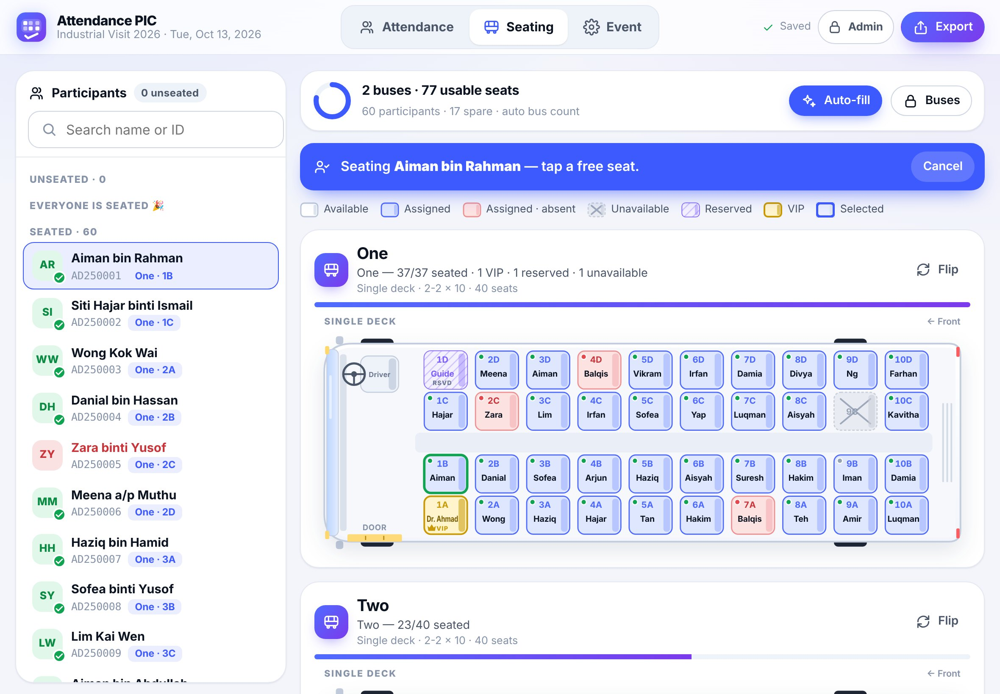
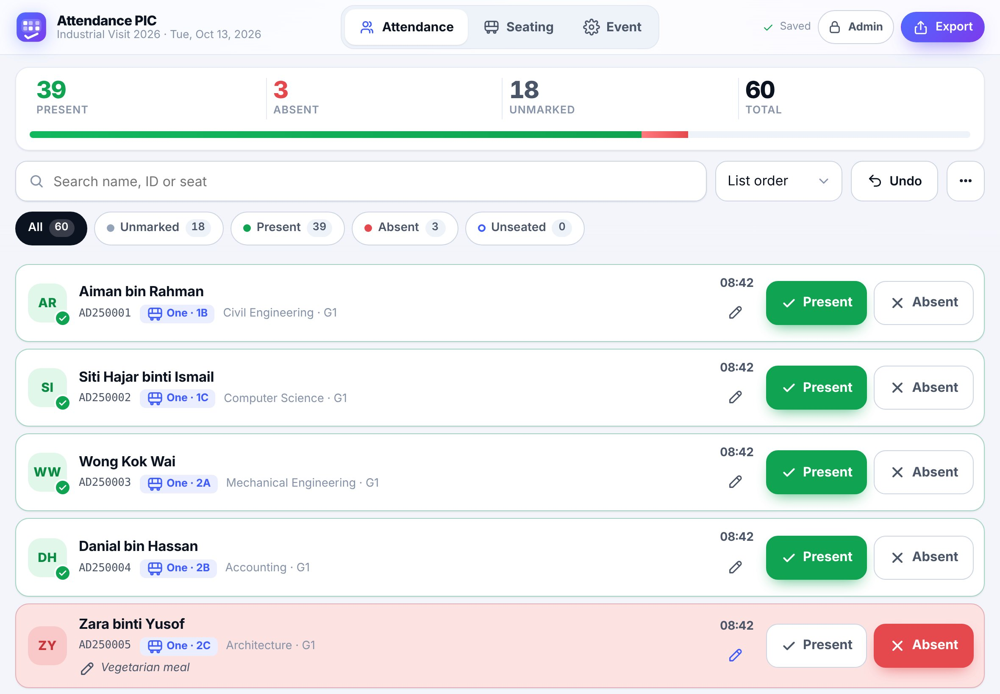
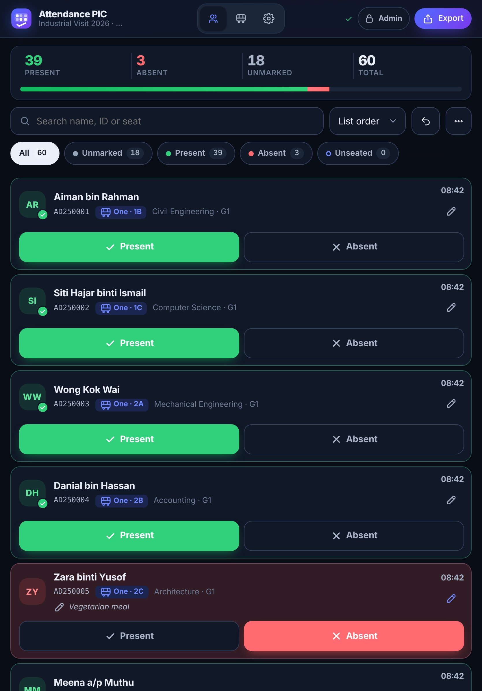
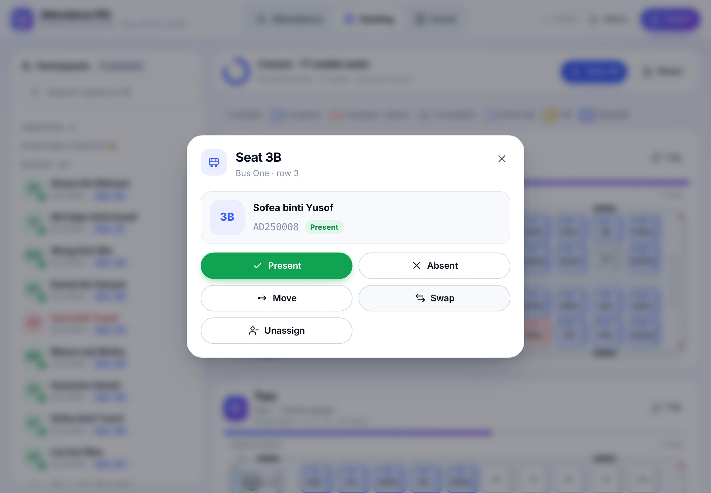
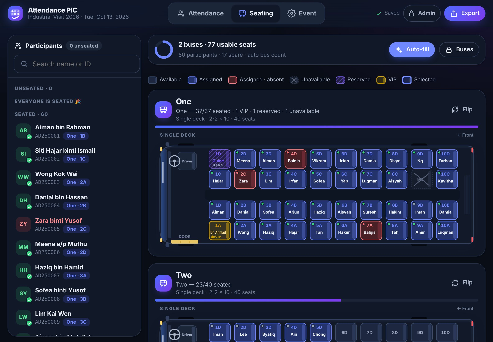
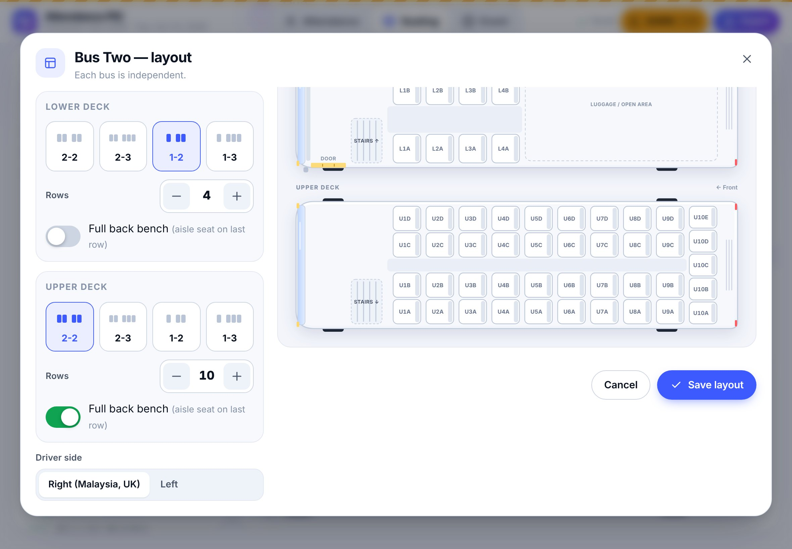
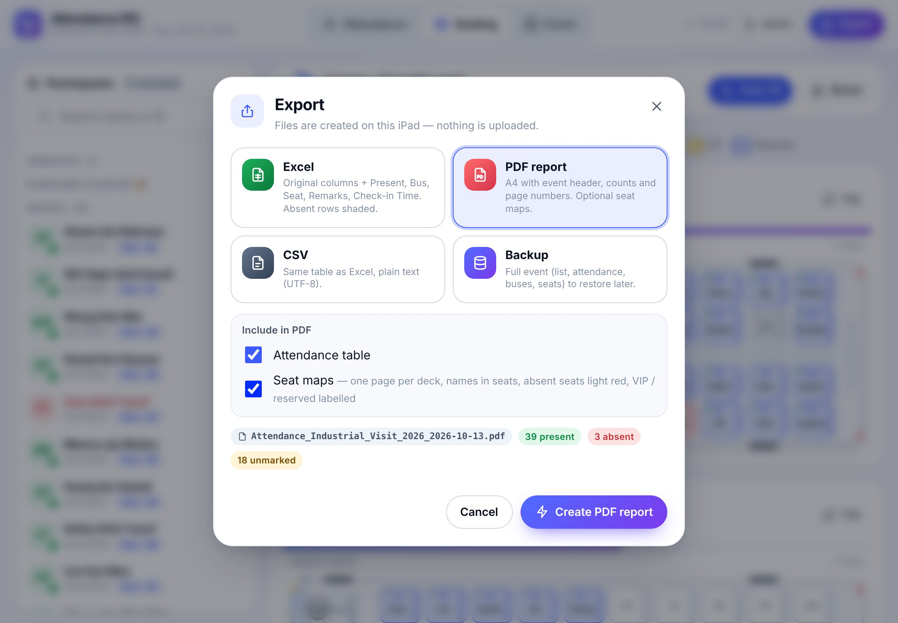
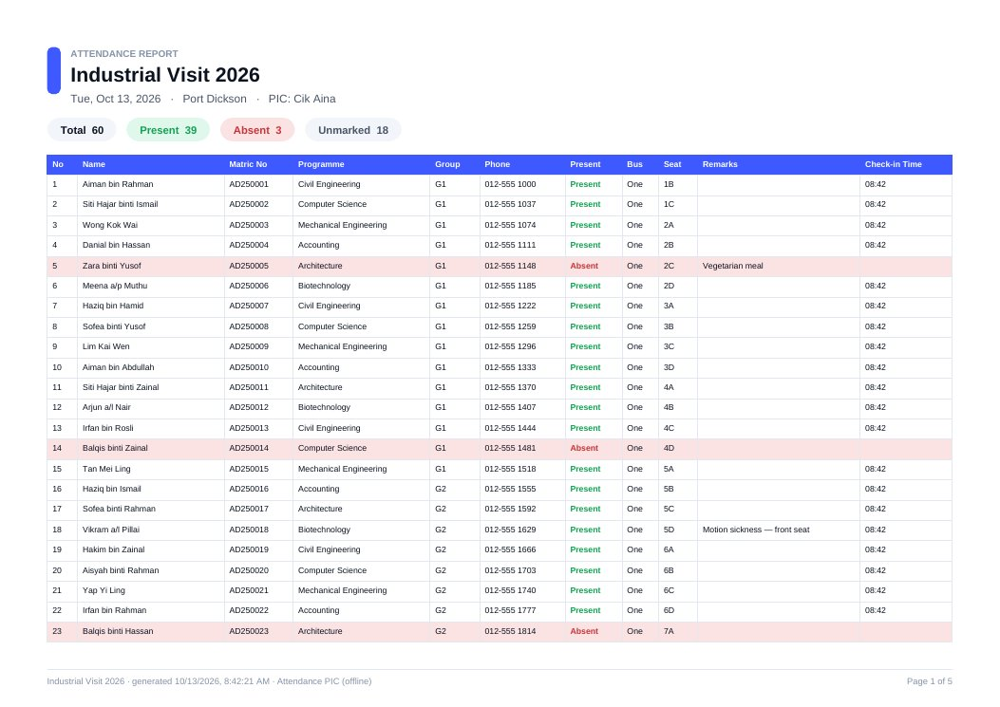
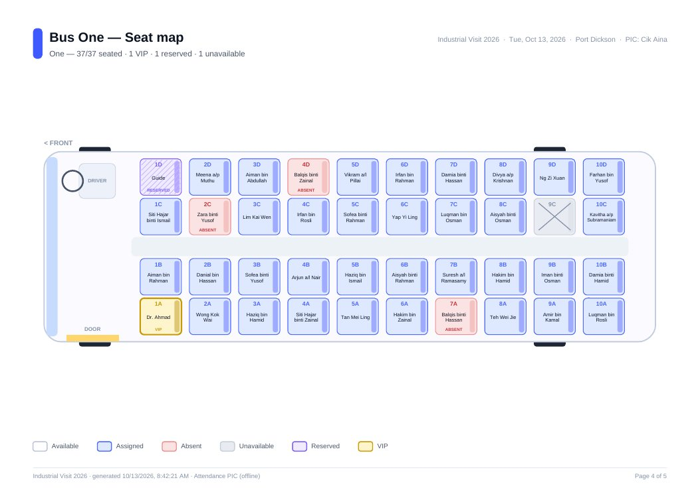
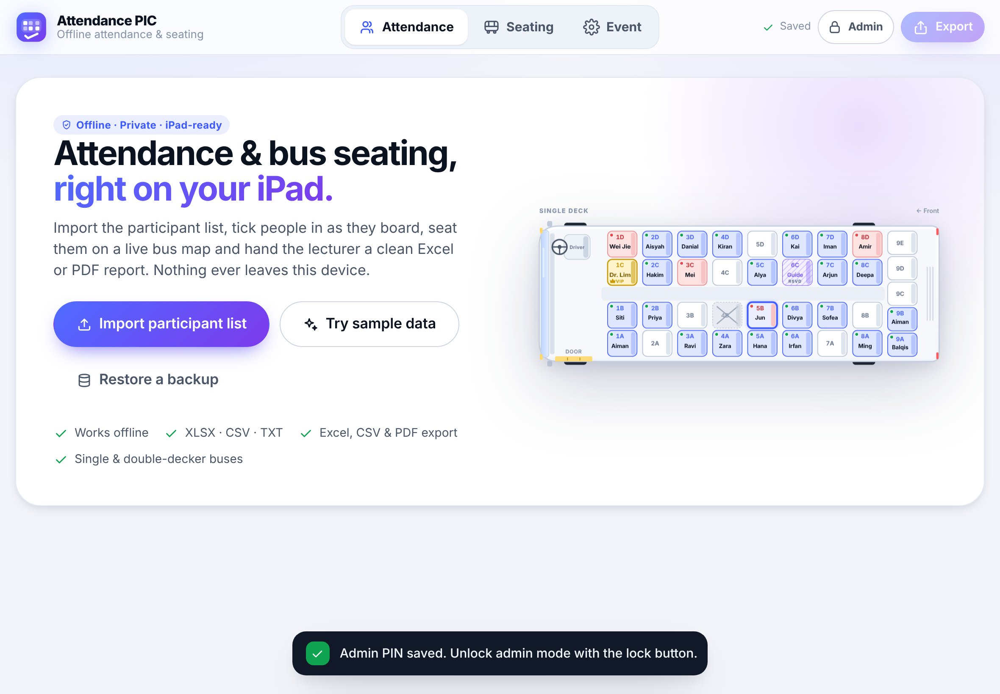

<p align="center">
  
</p>

<h1 align="center">Attendance PIC</h1>

<p align="center">
  <b>Offline-first attendance &amp; bus seating for the person-in-charge — built for iPad Safari.</b><br>
  Import the participant list, tick people in as they board, seat them on a live bus map,<br>
  and hand the lecturer a clean Excel or PDF report. No server, no sign-up — <b>no data ever leaves the device.</b>
</p>

<p align="center">
  <a href="../../actions/workflows/deploy.yml"></a>
  <a href="../../actions/workflows/test.yml"></a>
</p>

<p align="center">
  
</p>

---

## Why this exists

University trips (industrial visits, field trips, sports meets) start the same way: a PIC with a printed
list, a pen, and two buses outside. **Attendance PIC** turns an iPad into that clipboard — but faster,
searchable, and able to produce the report the lecturer wants the moment the bus leaves.

It is a **Progressive Web App**: GitHub Pages only hosts the code. After you open it once, it runs
**fully offline** from the Home Screen, and every name, matric number and seat stays in the iPad's own
storage.

## Features

| | |
|---|---|
| **📥 Import anything** | `.xlsx`, `.csv`, `.txt` (comma, tab or semicolon detected automatically). Preview, pick the **Name** and **ID** columns, choose key info to show. Existing `Present` / `Seat` / `Remarks` columns are reused. Duplicate IDs and empty rows are flagged. |
| **✅ Fast attendance** | Big **Present / Absent** buttons, automatic `HH:MM` check-in time, remarks, sticky search (name, ID or seat), filters (All · Unmarked · Present · Absent · Unseated), sorting, live counters, **undo**. |
| **🚌 Real bus layouts** | Top-down coach with nose, windscreen, driver, steering wheel, door, aisle and rear. Layouts **2-2, 2-3, 1-2, 1-3**, any number of rows, optional **back bench**, **double-decker** (L/U seats, stairs on both decks), flip the facing direction. |
| **🪑 Tap-tap seating** | Tap a person then a seat — or tap a seat and pick a person. Move, swap, unassign, mark present/absent from the seat. **Auto-fill** front to back, lower deck first, never moving anyone already seated. |
| **🔢 Automatic bus count** | Adds buses until everyone fits (usable = total − unavailable − reserved − VIP). Warns before removing a bus or seats that hold passengers. |
| **🔐 Admin mode** | PIN set on first launch, auto-lock after 5 minutes idle. Only admins mark seats **Unavailable / Reserved / VIP** (with labels such as “Dr. Ahmad”), edit layouts, add/remove/rename buses, reset or restore. |
| **📤 Exports** | **Excel** (absent rows shaded `#FDE2E2`), **CSV**, **PDF** (A4, event header, counts, repeated table header, page numbers, optional **seat maps** — one page per deck) and a **JSON backup**. Shared through the iPad share sheet (AirDrop, Mail, Files…) or downloaded. |
| **🌗 Made for iPad** | Portrait and landscape, light and dark mode, 44 px+ touch targets, Add to Home Screen, works in airplane mode. |
| **🛡️ Private by design** | Zero network requests at runtime besides the app's own files — enforced by a strict Content-Security-Policy **and** an automated test. No analytics, no fonts, no CDNs. |

## Screenshots

| Attendance (landscape) | Attendance (portrait, dark) |
|---|---|
|  |  |
| **Seat details** | **Seating (dark)** |
|  |  |
| **Bus layout editor (admin)** | **Export** |
|  |  |
| **PDF report** | **PDF seat map** |
|  |  |
| **First launch** | |
|  | |

*All names in the screenshots and in `/samples` are invented.*

## Use it

### The live app

Once GitHub Pages is enabled, the app lives at:

```
https://<github-user>.github.io/<repo>/
```

For this repository that is **https://schwi2807.github.io/attendance-pic/**.

### Install on the iPad

1. Open the link in **Safari** (other browsers on iPad cannot install web apps with full offline support).
2. Tap **Share → Add to Home Screen → Add**.
3. Launch **Attendance PIC from the Home Screen icon** from now on.
   > On iPadOS the Home Screen app keeps its **own storage**, separate from Safari tabs. Always use the icon so your data is in one place.
4. Create your **admin PIN** (4–8 digits) when asked.

### Pre-event checklist

- [ ] **Open the app once while online** (from the Home Screen icon) so it is cached for offline use. A toast says *“Ready to work offline”*.
- [ ] **Set the admin PIN** and remember it — it cannot be recovered (the only reset is erasing the app's data).
- [ ] **Test the import** with your real list a day before (Event → Import list). Check the Name/ID columns and the warnings.
- [ ] Fill in **Event details** (name, date, venue, PIC) — they appear on every export and in the file name.
- [ ] Set up **buses**: as admin, open *Seating → Buses* or a bus's *Layout*; mark broken seats **Unavailable**, lecturers' seats **Reserved/VIP**.
- [ ] **Turn on airplane mode and reopen the app** to prove it works offline.
- [ ] **Backup habit**: *Event → Download backup* after check-in, after seating, and before you delete the app or clear Safari data.

### On the day

1. **Attendance tab** — search or scroll, tap **Present** / **Absent**. Use *Unmarked* to see who is missing.
2. **Seating tab** — tap a person, then a seat. Or tap **Auto-fill**. Tap a seat to move, swap or unseat.
3. **Export** (top right) — choose Excel, PDF (with or without seat maps), CSV or Backup → **Share…** to AirDrop / email it.

## Deploy your own copy (fork)

1. **Fork** this repository (or use it as a template).
2. Pages needs a **public** repository on GitHub Free (or GitHub Pro/Team for private repos).
   Only **fake** sample data is committed here; a `.gitignore` keeps real `.xlsx` / `.csv` / `.txt` lists and a `/private/` folder out of Git.
3. **Settings → Pages → Build and deployment → Source: GitHub Actions.**
4. Push to `main` (or run the *Deploy to GitHub Pages* workflow manually). The workflow publishes `app/` + `samples/` and stamps the service worker with the commit so iPads pick up the new version (they show *“A new version of the app is ready — Reload”*).
5. Open `https://<you>.github.io/<repo>/` on the iPad and follow *Install on the iPad*.

## Privacy & security

- **Local only.** Data lives in the browser's IndexedDB on the device. There is no backend, account or sync.
- **No outbound requests.** `index.html` carries a Content-Security-Policy:
  `default-src 'self'; script-src 'self'; style-src 'self'; img-src 'self' data: blob:; connect-src 'self'; …`
  No inline scripts or styles, no CDNs (xlsx-js-style, jsPDF and jspdf-autotable are **vendored** in `app/vendor`).
  The Playwright suite fails if *any* request goes to another origin or if the CSP is violated.
- **Admin PIN** is stored as a salted SHA-256 hash. It is a guard-rail against accidental edits on a shared iPad, not encryption.
- **Exports** are created on the device and handed to the iPad share sheet or Downloads. Where they go next is up to you.
- **IDs on screen** can be masked (`AD••••••`) in *Event → Display*.

## Data formats

**Import** — any table with a header row. The importer guesses columns such as `Name` / `Nama` and
`Matric No` / `No. Matrik` / `Student ID`; you can change the mapping. Recognised and reused:
`Present` (Present/Yes/Hadir/1 → present, Absent/No/0 → absent), `Seat`, `Remarks`, plus `Bus` and
`Check-in Time` (so an exported file can be imported again).

**Export** — the original columns, followed by:

| Present | Bus | Seat | Remarks | Check-in Time |
|---|---|---|---|---|
| Present / Absent / blank | e.g. `One` | e.g. `3C`, `L3C`, `U3C` | free text | `HH:MM` (present only) |

Files are named `Attendance_<EventName>_<YYYY-MM-DD>.<ext>`. Before exporting, the app asks whether unmarked
people should become **Absent** or stay **blank**.

## Development

No build step — the app is plain ES modules, CSS and inline SVG.

```bash
npm install            # dev tools only (Playwright, libraries to vendor)
npm start              # http://localhost:4173/attendance-pic/  (same sub-path as GitHub Pages)
npm test               # Playwright, iPad Pro 11 viewport, Chromium
npm run test:webkit    # the same suite on WebKit (needs: npx playwright install webkit)
```

Helper scripts:

| Script | What it does |
|---|---|
| `npm run vendor` | Copies xlsx-js-style, jsPDF and jspdf-autotable from `node_modules` into `app/vendor` (+ licenses). |
| `npm run samples` | Regenerates the fake 60-person lists in `/samples` (`.xlsx`, `.csv`, tab-delimited `.txt`). |
| `npm run icons` | Renders the PWA icons from the SVG logo. |
| `npm run screenshots` | Regenerates the README screenshots with fake data. |

**Tests** (`tests/*.spec.js`, 52 cases) cover import of all formats, delimiter detection, warnings,
marking/undo/filters/search/sort, auto bus count (60 people → 2 buses), every layout (2-2, 2-3, 1-2, 1-3),
back bench, double-decker, flip, admin PIN lock/unlock/auto-lock/change, seat types changing capacity and
bus count, non-admins blocked from seat types, assign/move/swap/unassign, auto-fill, reload persistence,
XLSX/CSV/PDF (with and without seat maps)/JSON exports and restore, offline use via the service worker,
the CSP, and **zero off-origin requests**.

> **Browser note:** the build environment used for this project could not install Playwright's WebKit,
> so the suite was run on **Chromium with an iPad Pro 11 viewport** there. The *Tests* GitHub Action runs
> the same suite on **both Chromium and WebKit** (Safari's engine) on every push and pull request.

### Project structure

```
app/                     ← the whole PWA (this is what gets deployed)
  index.html             CSP, PWA meta tags
  sw.js                  offline cache (versioned per deploy)
  manifest.webmanifest
  css/                   design system (app.css) + seat maps (bus.css)
  js/
    main.js              boot, routing, top bar
    store.js             state + every action (autosaves through the repository)
    repo/                storage repository interface + IndexedDB implementation
    domain/              layout engine, capacity / bus count, data model
    io/                  parsing, column mapping, XLSX/CSV/PDF/JSON export, share
    ui/                  views, dialogs, bus SVG renderer, admin/PIN
    utils/               formatting, IDs, ID masking, SHA-256
  vendor/                xlsx-js-style, jsPDF, jspdf-autotable (+ LICENSES.md)
samples/                 FAKE participant lists (xlsx, csv, txt)
tests/                   Playwright suite + static test server
scripts/                 vendoring, samples, icons, screenshots
docs/                    decisions, Phase 2 notes, summary, screenshots
```

### Architecture in one minute

- **Storage repository** (`app/js/repo/repository.js`) is the only door to data: `getEvent`, `saveParticipant`,
  `assignSeat`, `setSeatType`, … Phase 1 implements it with IndexedDB; a server-backed version can replace it.
- **Bus layouts are pure JSON** (`deckType`, per-deck `layout`, `rows`, `backBench`, `driverSide`).
  Seats, labels, capacity and geometry are pure functions of that config (`app/js/domain/layout.js`);
  the on-screen SVG and the PDF seat maps draw from the same geometry.
- **Stable IDs** everywhere: `evt_…`, `ses_…`, `bus_…`, `p_…`, and seat IDs `"<busId>.<deck>.<row><letter>"`.
- See [`docs/DECISIONS.md`](docs/DECISIONS.md) for every judgement call and [`docs/PHASE2.md`](docs/PHASE2.md)
  for how online self-reservation can be added later.

## Known limitations

- PDFs use the built-in Helvetica font: characters outside Western European scripts (e.g. Chinese or Tamil
  script) print as `?`. Romanised names are fine. Excel/CSV keep every character.
- One attendance session per event in the UI (the data model already supports more).
- Undo history is kept in memory and resets when the app reloads.
- Data is per device and per browser: use **Backup / Restore** to move an event to another iPad.

## Credits

Built with [SheetJS / xlsx-js-style](https://github.com/gitbrent/xlsx-js-style) (Apache-2.0),
[jsPDF](https://github.com/parallax/jsPDF) (MIT) and [jsPDF-AutoTable](https://github.com/simonbengtsson/jsPDF-AutoTable) (MIT) —
see [`app/vendor/LICENSES.md`](app/vendor/LICENSES.md).
